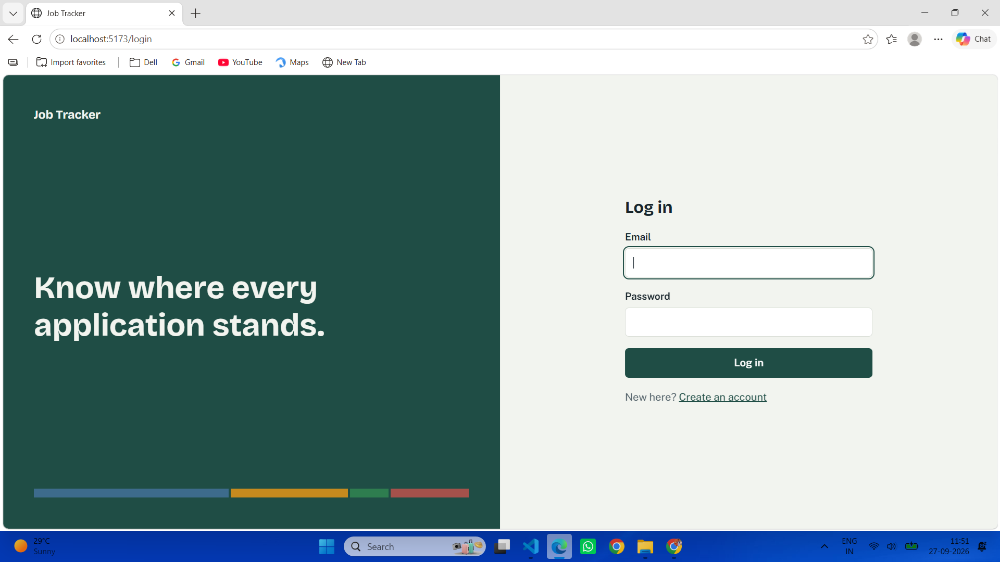
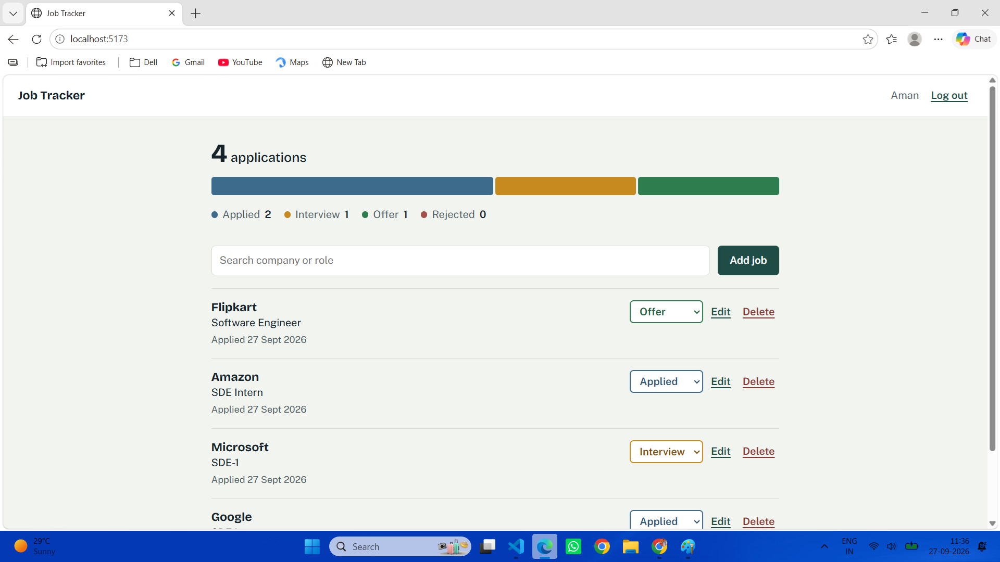

# Job Application Tracker

A full-stack web app to track job applications (company, role, status and notes) with a dashboard that shows your whole pipeline at a glance.

**Live demo:** https://job-tracker-one-taupe.vercel.app

| Login | Dashboard |
|---|---|
|  |  |

## Features

- Sign up and log in with JWT authentication (tokens expire after 7 days) and bcrypt-hashed passwords
- Add, edit and delete job applications
- Track each application as **Applied, Interview, Offer or Rejected**
- Search by company or role, and filter by status
- Dashboard with a visual status pipeline and live counts, powered by a MongoDB aggregation endpoint
- Every user can only see and change their own applications

## Tech stack

| Layer | Technology |
|---|---|
| Frontend | React 18, Vite, React Router |
| Backend | Node.js, Express |
| Database | MongoDB with Mongoose (MongoDB Atlas in production) |
| Auth | JWT, bcrypt |
| Hosting | Vercel (frontend), Render (backend), MongoDB Atlas (database) |

## API overview

The backend exposes 9 REST endpoints, plus a health check.

| Method | Endpoint | Description |
|---|---|---|
| POST | `/api/auth/register` | Create an account |
| POST | `/api/auth/login` | Log in and receive a JWT |
| GET | `/api/auth/me` | Get the logged-in user |
| GET | `/api/jobs` | List your jobs (supports search and status filter) |
| GET | `/api/jobs/stats/summary` | Count of jobs per status (dashboard) |
| POST | `/api/jobs` | Add a job |
| GET | `/api/jobs/:id` | Get one job |
| PUT | `/api/jobs/:id` | Update a job |
| DELETE | `/api/jobs/:id` | Delete a job |
| GET | `/api/health` | Health check |

All `/api/jobs` routes need the header `Authorization: Bearer <token>`.

## Run it locally

You need Node.js 18+ and a MongoDB database (local MongoDB or a free MongoDB Atlas cluster).

**1. Clone the repo**
```bash
git clone https://github.com/amankr04082005-beep/job-tracker.git
cd job-tracker
```

**2. Start the backend**
```bash
cd server
npm install
cp .env.example .env      # on Windows: copy .env.example .env
# open .env and fill in the values (see below)
npm run dev
```

**3. Start the frontend** (in a second terminal)
```bash
cd client
npm install
cp .env.example .env      # on Windows: copy .env.example .env
npm run dev
```

Open http://localhost:5173.

## Environment variables

**`server/.env`**

| Variable | Example | Purpose |
|---|---|---|
| `PORT` | `5000` | Port the API runs on |
| `MONGO_URI` | `mongodb://127.0.0.1:27017/job-tracker` | MongoDB connection string |
| `JWT_SECRET` | a long random string | Secret used to sign tokens |
| `CLIENT_URL` | `http://localhost:5173` | Frontend URL allowed by CORS |

**`client/.env`**

| Variable | Example | Purpose |
|---|---|---|
| `VITE_API_URL` | `http://localhost:5000/api` | Backend API base URL |

Generate a secure `JWT_SECRET` with:
```bash
node -e "console.log(require('crypto').randomBytes(48).toString('hex'))"
```

## Project structure

```
job-tracker/
├── client/                  # React frontend (Vite)
│   └── src/
│       ├── pages/           # AuthPage, Dashboard
│       ├── components/      # JobForm, JobRow, PipelineStrip
│       ├── AuthContext.jsx  # login state
│       └── api.js           # API helper
├── server/                  # Express backend
│   ├── models/              # User, Job (Mongoose)
│   ├── routes/              # auth, jobs
│   ├── middleware/          # auth, error handling
│   └── server.js
└── screenshots/
```

## Deployment

- **Database:** MongoDB Atlas (allow access from anywhere so Render can connect)
- **Backend:** Render web service, root directory `server`, start command `npm start`, with the environment variables above
- **Frontend:** Vercel project, root directory `client`, with `VITE_API_URL` pointing to the Render URL

## Author

Aman Kumar | [LinkedIn](https://www.linkedin.com/in/aman-kumar-3a5376291/) | [GitHub](https://github.com/amankr04082005-beep)
